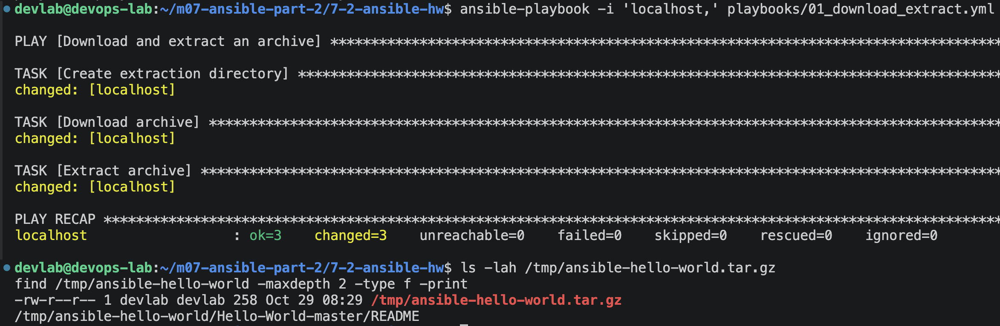
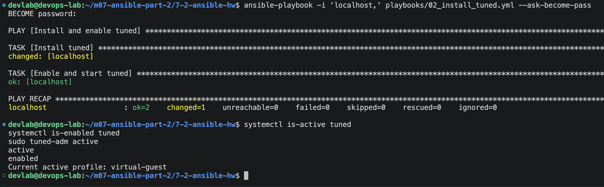
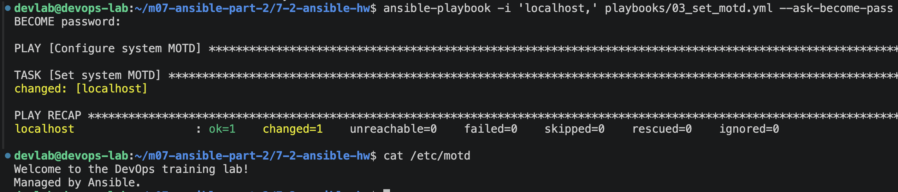
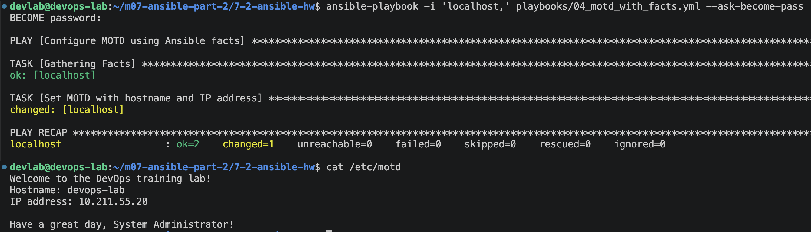
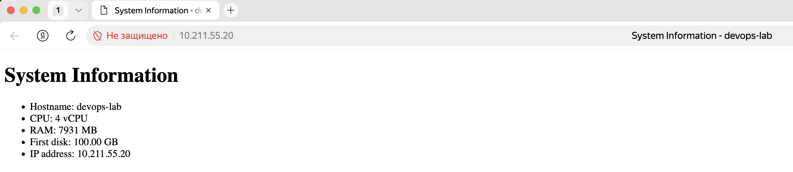
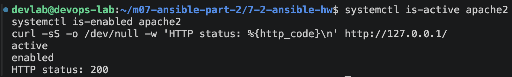
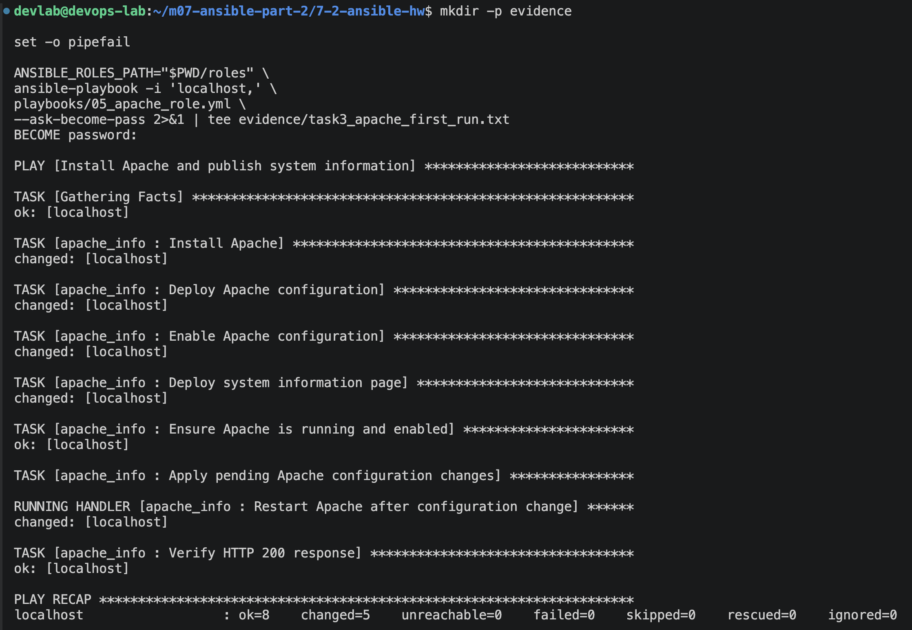
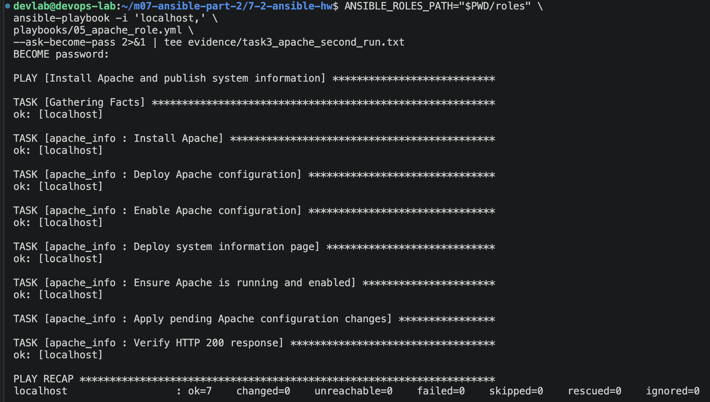
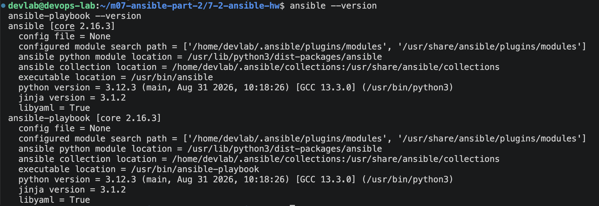

# Домашнее задание к занятию "`Ansible. Часть 2`" - `Штенгелов Игорь`


### Инструкция по выполнению домашнего задания

   1. Сделайте `fork` данного репозитория к себе в Github и переименуйте его по названию или номеру занятия, например, https://github.com/имя-вашего-репозитория/git-hw или  https://github.com/имя-вашего-репозитория/7-1-ansible-hw).
   2. Выполните клонирование данного репозитория к себе на ПК с помощью команды `git clone`.
   3. Выполните домашнее задание и заполните у себя локально этот файл README.md:
      - впишите вверху название занятия и вашу фамилию и имя
      - в каждом задании добавьте решение в требуемом виде (текст/код/скриншоты/ссылка)
      - для корректного добавления скриншотов воспользуйтесь [инструкцией "Как вставить скриншот в шаблон с решением](https://github.com/netology-code/sys-pattern-homework/blob/main/screen-instruction.md)
      - при оформлении используйте возможности языка разметки md (коротко об этом можно посмотреть в [инструкции  по MarkDown](https://github.com/netology-code/sys-pattern-homework/blob/main/md-instruction.md))
   4. После завершения работы над домашним заданием сделайте коммит (`git commit -m "comment"`) и отправьте его на Github (`git push origin`);
   5. В личном кабинете прикрепите и отправьте ссылку на решение в виде md-файла в вашем Github.
   6. Любые вопросы по выполнению заданий спрашивайте в разделе “Вопросы по заданию” в личном кабинете.
   
Желаем успехов в выполнении домашнего задания!
   
### Дополнительные материалы, которые могут быть полезны для выполнения задания

1. [Руководство по оформлению Markdown файлов](https://gist.github.com/Jekins/2bf2d0638163f1294637#Code)

---

**Среда:** Ubuntu Server 24.04 (`devops-lab`), Ansible Core 2.16.3

**Управляемый узел:** `localhost`, локальное подключение Ansible (`connection: local`)

### Задание 1. Три плейбука

#### 1.1. Скачать архив, создать каталог и распаковать его

**Плейбук:** [`playbooks/01_download_extract.yml`](playbooks/01_download_extract.yml)

Использованы штатные модули Ansible `get_url`, `file` и `unarchive`. Для примера скачивается архив ветки `master` демонстрационного репозитория `octocat/Hello-World` на GitHub. Каталог распаковки — `/tmp/ansible-hello-world`.

Используются три модуля: `ansible.builtin.get_url` (скачивание), `ansible.builtin.file` (создание каталога) и `ansible.builtin.unarchive` (распаковка). Полный исполняемый YAML приведён в плейбуке по ссылке выше.

**Вывод выполнения:** плейбук завершился успешно (`ok=3`, `changed=3`, `failed=0`); наличие распакованного `README` проверено.



#### 1.2. Установить `tuned`, запустить демон и включить автозапуск

**Плейбук:** [`playbooks/02_install_tuned.yml`](playbooks/02_install_tuned.yml)

Пакет установлен из стандартного репозитория Ubuntu модулем `ansible.builtin.apt`. Для запуска службы и включения автозагрузки применён `ansible.builtin.systemd_service`.

**Фрагмент задачи управления службой (YAML):**

```yaml
ansible.builtin.systemd_service:
  name: tuned
  state: started
  enabled: true
```

**Вывод выполнения:** `failed=0`; служба `active`, автозапуск `enabled`, активный профиль `virtual-guest`.



#### 1.3. Изменить `/etc/motd`, используя переменную

**Плейбук:** [`playbooks/03_set_motd.yml`](playbooks/03_set_motd.yml)

Текст приветствия определён переменной `motd_message` и записывается в `/etc/motd` с помощью `ansible.builtin.copy`.

**Фрагмент задачи записи MOTD (YAML):**

```yaml
ansible.builtin.copy:
  content: "{{ motd_message }}"
  dest: /etc/motd
```

**Вывод выполнения:** файл `/etc/motd` изменён, результат проверен чтением файла; `failed=0`.



---

### Задание 2. Приветствие MOTD с Ansible Facts

**Модифицированный плейбук:** [`playbooks/04_motd_with_facts.yml`](playbooks/04_motd_with_facts.yml)

Включён сбор фактов (`gather_facts: true`). Приветствие формируется из `ansible_facts` и содержит hostname, IP-адрес управляемого хоста и пожелание хорошего дня системному администратору.

**Выражения Jinja2 для получения имени хоста и IP-адреса:**

```jinja2
{{ ansible_facts['hostname'] }}
{{ ansible_facts['default_ipv4']['address'] }}
```

Это фрагменты выражений из плейбука, а не самостоятельный YAML-документ. Полный код формирования MOTD находится в [`04_motd_with_facts.yml`](playbooks/04_motd_with_facts.yml).

**Вывод выполнения:** `hostname=devops-lab`, `IP=10.211.55.20`; итоговый `/etc/motd` содержит необходимые сведения и пожелание. Плейбук завершился без ошибок.



---

### Задание 3. Роль для установки и настройки Apache

**Плейбук, подключающий одну роль:** [`playbooks/05_apache_role.yml`](playbooks/05_apache_role.yml)

**Исходники роли:** [`roles/apache_info/`](roles/apache_info/)

**Обязательный архив роли:** **[`archives/apache_info.tar.gz`](archives/apache_info.tar.gz)**

Статья для ознакомления: [«Ansible — это вам не bash»](https://habr.com/ru/post/494738/). В реализации роли используются штатные модули Ansible, **без `shell` и `command`**.

#### Плейбук подключения роли

```yaml
---
- name: Install Apache and publish system information
  hosts: localhost
  connection: local
  gather_facts: true
  become: true
  roles:
    - apache_info
```

При запуске указывается каталог пользовательских ролей:

```bash
ANSIBLE_ROLES_PATH="$PWD/roles" ansible-playbook -i 'localhost,' \
  playbooks/05_apache_role.yml --ask-become-pass
```

#### 3.1. Установить веб-сервер Apache

**Решение:** роль устанавливает пакет `apache2` штатным модулем `ansible.builtin.apt`.

```yaml
- name: Install Apache
  ansible.builtin.apt:
    name: "{{ apache_package }}"
    state: present
    update_cache: true
  become: true
```

Исходный код: [`roles/apache_info/tasks/main.yml`](roles/apache_info/tasks/main.yml).

#### 3.2. Сформировать index.html с CPU, RAM, первым HDD и IP; реализовать handler

**Решение:** `ansible.builtin.template` формирует `/var/www/html/index.html` из [`templates/index.html.j2`](roles/apache_info/templates/index.html.j2), подставляя характеристики хоста из Ansible Facts.

```html
<li>Hostname: {{ ansible_facts['hostname'] }}</li>
<li>CPU: {{ ansible_facts['processor_vcpus'] }} vCPU</li>
<li>RAM: {{ ansible_facts['memtotal_mb'] }} MB</li>
<li>First disk: {{ ansible_facts['devices']['sda']['size'] }}</li>
<li>IP address: {{ ansible_facts['default_ipv4']['address'] }}</li>
```

В учебной Ubuntu первым диском является `/dev/sda`; Ansible Facts возвращают `100.00 GB`. Этот пример привязан к имени диска `sda`, поэтому на другом узле шаблон может потребовать адаптации.

**Handler:** перезапуск Apache привязан через `notify` только к изменениям конфигурации Apache (`apache-info.conf` и её включению), но не к обновлению HTML-страницы.

```yaml
- name: Restart Apache after configuration change
  ansible.builtin.systemd_service:
    name: "{{ apache_service }}"
    state: restarted
```

Исходники: [`handlers/main.yml`](roles/apache_info/handlers/main.yml), [`templates/apache-info.conf.j2`](roles/apache_info/templates/apache-info.conf.j2), [`tasks/main.yml`](roles/apache_info/tasks/main.yml).

**Вывод выполнения:** во время первого запуска handler сработал при создании конфигурации; при повторном запуске без изменений не вызывался. Проверка изменения только HTML отдельно не выполнялась.

**Веб-страница по умолчанию** открыта с MacBook по адресу `http://10.211.55.20/`. На ней отображаются `devops-lab`, `4 vCPU`, `7931 MB` RAM, `100.00 GB` первого диска и IP `10.211.55.20`.



#### 3.3. Открыть порт 80 при необходимости, запустить Apache и включить автозагрузку

**Решение:** Apache прослушивает порт 80; доступность подтверждена проверками с Ubuntu и MacBook. Отдельного изменения правил firewall не выполнялось: HTTP-доступ с MacBook к порту 80 подтверждён. Запуск и автозагрузка обеспечиваются `ansible.builtin.systemd_service`.

```yaml
- name: Ensure Apache is running and enabled
  ansible.builtin.systemd_service:
    name: "{{ apache_service }}"
    state: started
    enabled: true
  become: true
```

**Вывод выполнения:** `systemctl is-active apache2` → `active`, `systemctl is-enabled apache2` → `enabled`, HTTP-запрос → `200`.



#### 3.4. Проверить доступность веб-сайта (HTTP 200, модуль uri)

**Решение:** в роли используется именно `ansible.builtin.uri`, а не `shell` или `command`.

```yaml
- name: Verify HTTP 200 response
  ansible.builtin.uri:
    url: "http://127.0.0.1:{{ apache_listen_port }}/"
    status_code: 200
    return_content: true
  register: apache_http_result
  changed_when: false
```

**Вывод выполнения:** задача `Verify HTTP 200 response` завершилась с `ok` на обоих запусках. Результат показан на скриншотах `PLAY RECAP` ниже и сохранён в журналах.

#### Вывод первого запуска роли

**Результат Ansible:** `ok=8`, `changed=5`, `unreachable=0`, `failed=0`. Handler перезапуска Apache сработал при создании конфигурации; модуль `uri` завершился успешно.



**Полный консольный вывод:** [`evidence/task3_apache_first_run.txt`](evidence/task3_apache_first_run.txt).

#### Повторный запуск: проверка идемпотентности

**Результат Ansible:** `ok=7`, `changed=0`, `unreachable=0`, `failed=0`. Конфигурация не менялась, handler не запускался, HTTP-проверка осталась успешной.



**Полный консольный вывод:** [`evidence/task3_apache_second_run.txt`](evidence/task3_apache_second_run.txt).

---

### Дополнительная информация



Работы выполнены на учебной виртуальной машине Ubuntu. Системные изменения и результаты зафиксированы в приведённых файлах и изображениях.
